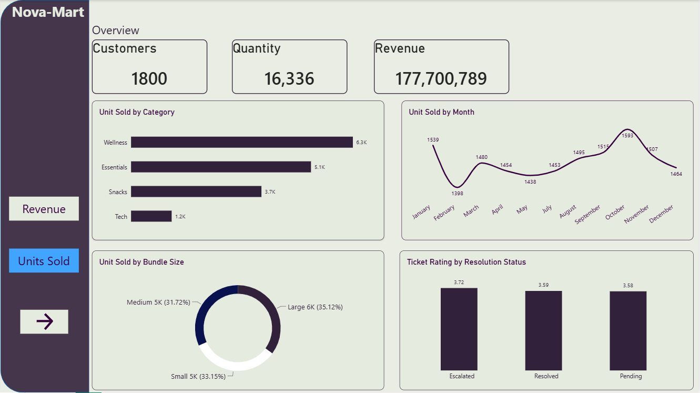
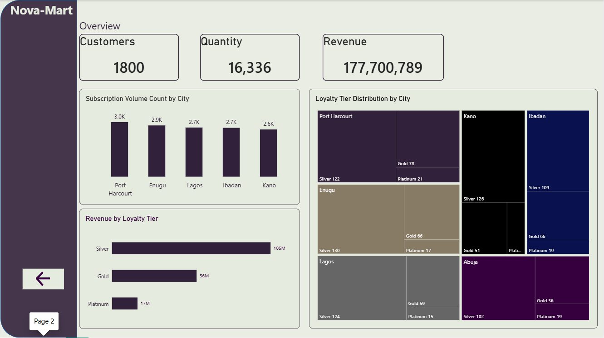

# NovaMart — Customer & Product Insights
### PostgreSQL (SQL) + Power BI | Data Analytics Portfolio Project

**NovaMart** is a fictional Nigerian subscription retailer. This end-to-end analytics project uses **PostgreSQL SQL queries** to explore business performance and **Power BI** to present product, customer, and loyalty insights.

> **This is both an SQL analysis project and a Power BI reporting project.** The original SQL script and editable Power BI report are included below.

## Project objectives
- Identify the three bundles with the highest paid subscription counts.
- Compare average customer spend across loyalty tiers.
- Count failed payments by payment method.
- Calculate revenue by active bundle category using paid payments.
- Find the support issue type with the lowest average rating.

## Tools and skills
**PostgreSQL / SQL:** INNER JOIN, COUNT, AVG, SUM, MIN, WHERE, GROUP BY, ORDER BY, LIMIT, multi-table analysis.

**Power BI:** data modeling, DAX, KPI cards, bar charts, treemaps, customer segmentation and dashboard design.

## SQL analysis
**[View the original SQL queries →](Nova%20Sql.sql)**

The script contains five analyses:

| Question | SQL approach |
| --- | --- |
| Which bundles have the most subscriptions? | Join bundles, subscriptions and payments; filter Paid; count subscriptions |
| How much does each loyalty tier spend on average? | Join customers, subscriptions and payments; calculate AVG(total_value) |
| Which payment methods have failed payments? | Filter Failed payments and count by method |
| Which active bundle categories generate the most revenue? | Join bundles, subscriptions and payments; sum paid transaction values |
| Which support issue type has the lowest rating? | Group support tickets by issue type; rank by average rating |

**Tables referenced:** `bundles`, `subscriptions`, `payments`, `customers`, `support_tickets`.

*Note: The original SQL file is preserved as submitted. The query counting subscriptions joins to payments, so counts can reflect multiple paid payments per subscription where those exist.*

## Power BI report
**[Download the editable Power BI file (.pbix) →](Nova_Mart.pbix)**

### Product performance

### Customer and loyalty insights

## Dashboard highlights
- **1,800** customers
- **16,336** units sold
- **177,700,789** revenue displayed in the report (currency not specified)
- Wellness leads category unit demand at approximately **6.3K** units.
- Silver leads loyalty-tier revenue at approximately **105M**.
- Port Harcourt leads city-level subscription volume at approximately **3.0K**.

## Business recommendations
1. Focus inventory and merchandising on high-demand product categories.
2. Investigate retention and upsell opportunities for loyalty segments.
3. Examine failed payments by method to reduce checkout friction.
4. Review low-rated support issue types for service improvements.

## Files
| File | Purpose |
| --- | --- |
| [Nova Sql.sql](Nova%20Sql.sql) | Original PostgreSQL analysis queries |
| [Nova_Mart.pbix](Nova_Mart.pbix) | Editable Power BI project |
| [product-performance.jpg](product-performance.jpg) | Product performance dashboard screenshot |
| [customer-loyalty.jpg](customer-loyalty.jpg) | Customer and loyalty dashboard screenshot |

## Project context
This is a portfolio case study using a fictional retailer's data. Figures are descriptive, not evidence of causal business impact. Monthly labels in the report group matching months across years.

**Portfolio:** [Emmanuel Sey Williams](https://seywilliams.github.io/) · [Detailed case study](https://seywilliams.github.io/novamart.html)
